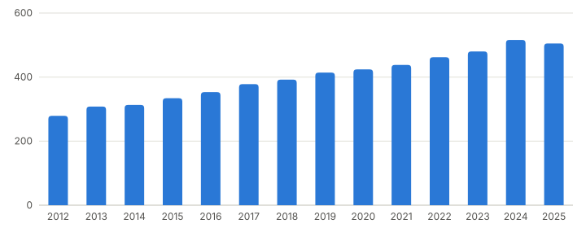
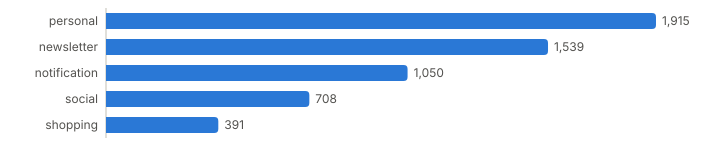
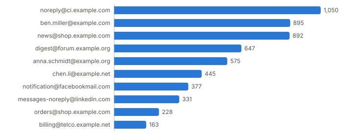

# Email statistics

6,755 emails, each counted once, also if it is in several folders or sources.
Generated on 2026-01-01 00:00:00Z by
[imap-statistics](https://github.com/phip1611/imap-statistics) 0.1.0.

## Accounts

| Account | Address        | Server               | Received | Sent |
| :------ | :------------- | :------------------- | -------: | ---: |
| work    | me@example.com | imap.example.com:993 |    2,884 |  916 |
| private | me@example.org | imap.example.org:993 |    3,066 |  236 |

An email in several accounts counts once in the other sections, but for each
account here. An email counts as sent if it came from an address of an account,
or is in a Sent folder.

## Emails per year

| Year | Received | Sent |
| :--- | -------: | ---: |
| 2012 |      279 |   74 |
| 2013 |      308 |   71 |
| 2014 |      313 |   78 |
| 2015 |      334 |   69 |
| 2016 |      353 |   78 |
| 2017 |      378 |   79 |
| 2018 |      392 |   86 |
| 2019 |      414 |   79 |
| 2020 |      424 |   83 |
| 2021 |      438 |   90 |
| 2022 |      462 |   96 |
| 2023 |      480 |   85 |
| 2024 |      516 |   87 |
| 2025 |      505 |   97 |

Left out for lack of a usable date: 7 emails.

## Emails per category

| Category     | Emails | Share | Description                                  |
| :----------- | -----: | ----: | :------------------------------------------- |
| personal     |  1,915 |   34% | everything else, mostly from people          |
| newsletter   |  1,539 |   27% | a newsletter, mailing list, or advertisement |
| notification |  1,050 |   18% | sent by a program, e.g. a security code      |
| social       |    708 |   12% | from a social network or dating site         |
| shopping     |    391 |    6% | about an order, payment, or delivery         |

Only received emails count. The categories come from simple rules on the
headers, so a few emails are in the wrong category.

## Top senders

10 sender addresses in received emails. The top 10 sent 100% of all received
emails. The name is the one that the sender used most often.

|   # | Sender                        | Name          | Emails |
| --: | :---------------------------- | :------------ | -----: |
|   1 | noreply@ci.example.com        | Example CI    |  1,050 |
|   2 | ben.miller@example.com        | Ben Miller    |    895 |
|   3 | news@shop.example.com         | Example Shop  |    892 |
|   4 | digest@forum.example.org      | Example Forum |    647 |
|   5 | anna.schmidt@example.org      | Anna Schmidt  |    575 |
|   6 | chen.li@example.net           | Chen Li       |    445 |
|   7 | notification@facebookmail.com | Facebook      |    377 |
|   8 | messages-noreply@linkedin.com | LinkedIn      |    331 |
|   9 | orders@shop.example.com       | Example Shop  |    228 |
|  10 | billing@telco.example.net     | Example Telco |    163 |

## Top recipients

4 recipient addresses in sent emails, from To, Cc, and Bcc. An email to several
recipients counts for each of them. Own addresses do not count.

|   # | Recipient                | Emails |
| --: | :----------------------- | -----: |
|   1 | ben.miller@example.com   |    754 |
|   2 | chen.li@example.net      |    754 |
|   3 | anna.schmidt@example.org |    236 |
|   4 | team@example.com         |    162 |
